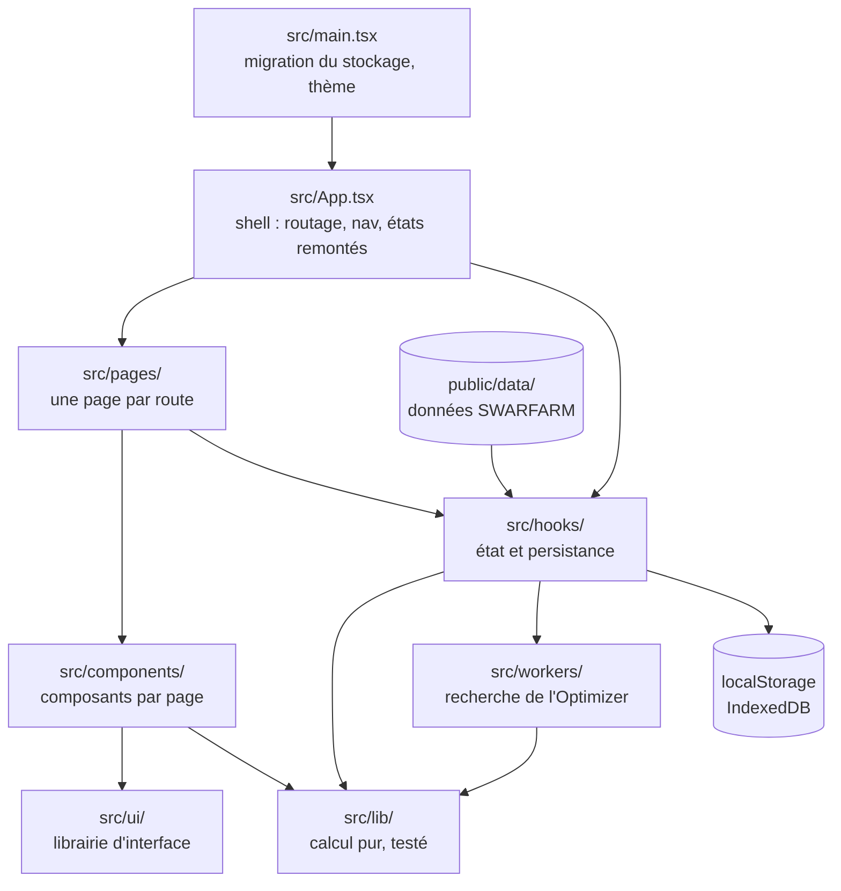
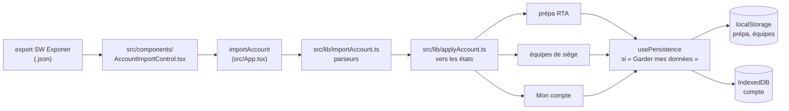
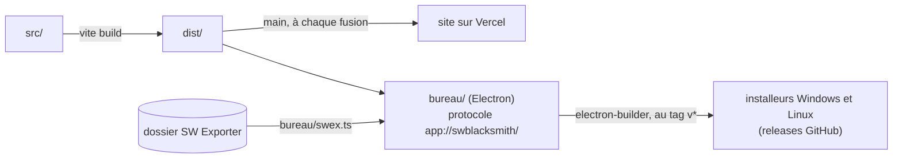

# Architecture

Comment l'app est construite, et quels fichiers ouvrir pour une demande donnée. Le comportement
attendu de chaque page est dans [02-app/](../02-app/README.md) : ici on dit *où*, pas *quoi*.

## Les modules

- **Le calcul vit dans `src/lib/`**, en fonctions pures, sans React : il se vérifie isolément.
  Jamais de logique dans un composant.
- **L'état partagé entre pages est instancié dans `src/App.tsx`** puis passé en prop : c'est ce qui
  permet à un import de compte d'alimenter RTA, siège et compte d'un seul geste.
- **Le calcul lourd tourne hors du fil principal**, dans les Web Workers de `src/workers/`.

## Le chemin d'un import de compte

Détail : [transverse/feat-import-compte/](../02-app/transverse/feat-import-compte/README.md).

## Le site et l'application de bureau

La même app sert les deux. Le code propre au bureau vit dans `bureau/`, hors de `src/` : il tourne
dans Node. Côté page, `src/lib/bureau.ts` (`estBureau()`) dit si l'on est au bureau. Détail :
[bureau/](../02-app/bureau/README.md).

## Le shell — `src/App.tsx`

Fichier central, gros et volontairement : il tient tout ce qui doit être partagé entre pages.

- **Routage** : `parseHash()` sur `window.location.hash`, sans router externe — table des adresses
  et garde-fou : [feat-navigation/barre-laterale-et-adresses.md](../02-app/transverse/feat-navigation/barre-laterale-et-adresses.md).
- **Nav** : barre latérale (`Sidebar`), barre supérieure (`TopBar`), onglets mobiles
  (`MobileTabs`), recherche de nav (`SidebarSearch`).
- **Écran partagé** (bureau) : l'adresse décrit le volet actif, l'état des volets
  (`useStickyState`, `src/lib/volets.ts`) tient l'autre ; `pageDe()` rend une page par
  volet, dans un `VoletEcran` (en-tête, verrou, « Options »), les deux posés dans
  `DeuxVolets`. Le responsive des pages suit leur volet par le plugin PostCSS
  `scripts/lib/postcssVolets.ts` : [ecran-partage.md](../02-app/transverse/feat-navigation/ecran-partage.md).
- **États instanciés ici puis passés en prop** : `useRtaState`, `useSiegeState`, `useSiegeRecos`,
  `useOptimizerState`, `useMonsters`, `useCustomMonsters`.
- **Fusion des monstres officiels et des monstres perso** (`allMonsters`), passée aux pages qui
  en ont besoin (RTA, Siège, Mon compte, Outils).
- **Import de compte global** (`importAccount`) et **`clearAllData()`**.
- **Sauvegarde de session** (`sauvegarderSession`, `sauvegarderSessionSous`, Ctrl+S) :
  [transverse/feat-sauvegarde-session.md](../02-app/transverse/feat-sauvegarde-session.md).

⚠️ **Cycle d'imports** : `src/pages/AccountPage.tsx` et `src/pages/OutilsPage.tsx` importent des
types depuis `src/App.tsx`. Un parcours automatique des dépendances depuis ces deux pages remonte
donc **toute la codebase** : se fier à la table « Par écran », pas à un arbre calculé.

⚠️ **`src/ui/index.ts` est un baril** : importer un seul composant depuis `src/ui/` fait apparaître
tous les autres dans n'importe quelle analyse de dépendances.

## Par écran — quoi ouvrir

| Écran | Route | Page | Composants propres | Fiche |
| --- | --- | --- | --- | --- |
| Accueil | `#/` | `src/pages/HomePage.tsx` | `ElementIcon`, `src/data/releases.ts` | [accueil/](../02-app/accueil/README.md) |
| **RTA** | `#/rta`, `#/rta/ami` | `src/pages/RtaPage.tsx` | tout `src/components/rta/` | [rta/](../02-app/rta/README.md) |
| **Siège** | `#/siege/defense`, `/offense`, `/recommandations` | `src/pages/SiegePage.tsx` | tout `src/components/siege/` | [siege/](../02-app/siege/README.md) |
| **Mon compte** | `#/compte`, `/runes`, `/artefacts` | `src/pages/AccountPage.tsx` | tout `src/components/account/` | [compte/](../02-app/compte/README.md) |
| **Outils** | `#/outils/optimizer`, `/speed-tuning` | `src/pages/OutilsPage.tsx` | tout `src/components/outils/` | [outils/](../02-app/outils/README.md), [optimizer/](../02-app/optimizer/README.md), [speed-tuning/](../02-app/speed-tuning/README.md), [degats-reels/](../02-app/degats-reels/README.md) |
| Bestiaire | `#/bestiary` | `src/pages/BestiaryPage.tsx` | `MonsterGrid`, `FilterBar`, `SearchBar`, `MonsterDetailDialog`, `Pager` | [bestiaire/](../02-app/bestiaire/README.md) |
| Paramètres | `#/parametres` | `src/pages/SettingsPage.tsx` | `SettingsMenu`, `AccountImportControl` | [feat-navigation/compte-et-parametres.md](../02-app/transverse/feat-navigation/compte-et-parametres.md) |
| Mécaniques | `#/mecaniques` | `src/pages/MechanicsPage.tsx` | — (page statique) | [mecaniques/](../02-app/mecaniques/README.md) |
| Nouveautés | `#/releases` | `src/pages/ReleasesPage.tsx` | `src/data/releases.ts` | [nouveautes/](../02-app/nouveautes/README.md) |
| Télécharger (site seulement) | `#/telecharger` | `src/pages/TelechargerPage.tsx` | `src/lib/bureau.ts` (`TELECHARGEMENTS`), `src/components/IconesSystemes.tsx` | [telecharger/](../02-app/telecharger/README.md) |
| Arène | `#/arene` | `src/pages/ComingSoon.tsx` | — | [arene/](../02-app/arene/README.md) |

### Détail des écrans denses

**RTA** — `src/pages/RtaPage.tsx`, puis dans `src/components/rta/` :

| Fichier | Rôle |
| --- | --- |
| `RtaSection.tsx` | une section (groupe classé) et ses cartes |
| `RtaCard.tsx` | la carte d'un monstre : vitesse, tick, équipement |
| `CategoryBar.tsx` | barre des catégories, création et édition, choix des monstres |
| `CategoryRing.tsx` | l'anneau de couleurs d'une carte |
| `TurnOrder.tsx` | ordre de tour calculé |
| `RtaSearch.tsx` | ajout d'un monstre à la prépa |
| `RtaBackupBar.tsx` | sauvegarde, restauration, partage, import |
| `RtaAmiSection.tsx` | le sous-onglet « Ami » : ouvre le fichier (prépa exportée **ou** export SWEX), ou l'invite |
| `RtaFriendView.tsx` | lecture d'une prépa partagée |
| `RtaValidationReport.tsx` | rapport de lecture d'un fichier, **partagé** par la barre de sauvegarde et le sous-onglet Ami |
| `DesyncBadge.tsx` | la vitesse saisie ≠ les runes importées |

Hooks : `useRtaState`, `useRtaCategories`, `useRtaBackup`, `useRuneMetric`, `useOvercapDisplay`,
`useStickyState`. Lib : `rtaShare`, `speed`, `stats`, `gearSync`, `artifacts`, `monsterForms`.

**Siège** — dans `src/components/siege/` : `SiegeBoard.tsx` (défense et offense), `SiegeTeam.tsx`,
`RecoBoard.tsx` + `RecoCard.tsx` (recommandations), `LeadPill.tsx`. Hooks `useSiegeState`,
`useSiegeRecos`. Lib `recoMatch`, `recoSearch`, `recoShare`, `recoFromSiege`, `recoDefenses` (la
vue Défense, calculée à partir des decks), `ownedBuilds`, **`siegeStatut`** (le statut
vert / orange / rouge d'une équipe en mode « Vérifier mes tick ATB » — pur et testé, il ne vit pas
dans la carte).

**Mon compte** — dans `src/components/account/`, `RunesSection.tsx` et `ArtifactsSection.tsx`
sont les deux racines ; dessous : `RunesList`, `RunesSummary` + `BuildsRapides`, `RunesCurve` +
`CurveChart` + `curveColors`, `RunesCompare`, `RunesOptim`, `SetFilter`, `SlotFilter`,
`SubSearchBar` + `SubSearchDialog`, `Pager`, `SummaryBits`, `ArtifactsList`, `ArtifactsSummary`.
Lib `accountStore` (IndexedDB), `accountViews`, `runeSort`, `runeOptim`, `buildsRapides`,
`monsterSort`, `crafts`.

**Optimizer** — dans `src/components/outils/` : `OptimizerSection.tsx` (racine),
`MonsterSourcePicker` (recherche — deux modes, bestiaire ou compte réel), `OptimizerListPicker`
(listes de travail), `SetComboPicker`, `BuildCandidateCard` — fiche :
[optimizer/ecran/](../02-app/optimizer/ecran/README.md). Hooks `useOptimizerState` +
`useBuildOptimSearch` (saisie et recherche, jamais persistées) et `useOptimizerLists` (listes de
travail créées par l'utilisateur + runes validées scopées par liste — seul état PERSISTÉ de
l'écran — fiche : [optimizer/feat-listes-et-reservation.md](../02-app/optimizer/feat-listes-et-reservation.md)).
Moteur `src/lib/runeBuildOptim.ts`, exécuté dans `src/workers/runeBuildOptim.worker.ts` et
`src/workers/buildHalf.worker.ts` — [03-developpeur/optimizer/](../03-developpeur/optimizer/README.md).
⚠️ Disposition mobile dédiée pour « Monstre & équipement » seul — le reste de l'écran n'est pas
encore audité en mobile.

Les cartes de la grille des réglages vivent dans `src/components/outils/optimizer/`, une par
fichier, sans état propre : `OptimizerSection` garde l'état et la logique et les leur passe par
props. « Monstre & équipement » (`MonstreEquipement`, avec `MonstreEtListe` et
`ExemplaireEtFiche` au bureau, `MonstreEquipementTelephone` au doigt, `BandeauBuildValide`,
`BoutonValiderBuild` ; la liste de travail `MonstresDeLaListe` — zone C —, le choix de
l'exemplaire `ChoixExemplaire` — zone D —, le sélecteur de listes `SelecteurListes`),
« Critères de recherche » (`CriteresRecherche` : `SetDeRunes`,
`StatPrincipaleImposee`, `Conditions`), « Artéfacts et reliques » (`ArtefactsEtReliques`,
`MeilleursArtefacts`, `Relique`), `CarteEtatMonstre`, « Exclusion de runes »
(`CarteExclusionRunes`, `ExclusionRunesContenu`, `RunesDejaUtilisees`, `ExclusionMonstrePrecis`,
`RunesImposees`, `TitreExclusionRunes`), « Réglages avancés » (`CarteReglagesAvances`,
`ReglagesAvancesContenu`, `TitreReglagesAvances`), `EstimationPool`, et au doigt le panneau
« Options de recherche » (`OptionsRechercheTelephone`). Les gestes restent dans
`OptimizerSection`, nommés et passés aux cartes (`choisirMembreDeLaListe`,
`choisirExemplaireZoneD`, `choisirSetsRecherches`). Constantes
partagées : `src/components/outils/optimizer/constantes.ts` ; types :
`src/components/outils/optimizer/types.ts`.

Au format bureau, `OptimizerSection` rend la page en colonnes
([02-app/optimizer/ecran/](../02-app/optimizer/ecran/README.md)) par `PageBureau`
(`src/components/outils/optimizer/bureau/PageBureau.tsx`) : racine en requêtes de conteneur,
agencements A1, A2, A3, contrôle à onglets et colonnes repliables, colonnes fixes en A3 ; ses
seuils et l'état de départ des onglets viennent de `src/lib/optimizerColonnes.ts`. Le téléphone
garde la grille des cartes ci-dessus. Les boîtes de cette page vivent dans
`src/components/outils/optimizer/bureau/` : la liste de
travail (`ListeDeTravailBureau`), le set de runes compact (`SetDeRunesCompact`), les principales
imposées (`PrincipalesImposeesBureau`), les conditions (`ConditionsBureau`), l'état du monstre
réduit aux buffs et au lead (`EtatMonstreEssentiels`) et le contrôle à onglets des colonnes
repliables (`OngletsColonnes`, décidé par `src/lib/optimizerColonnes.ts`) ; dans la colonne
« Artéfacts et relique », la carte des artéfacts et de la relique (`ArtefactsEtReliqueBureau`) et
celle des meilleurs artéfacts (`MeilleursArtefactsBureau`) ; dans la colonne « Aura, exclusion,
avancés », les sets d'aura (`SetsAuraBureau`), l'exclusion de runes (`ExclusionRunesBureau`) et les
réglages avancés (`ReglagesAvancesBureau`), en ligne ; dans la colonne de droite, « Exemplaire »
(`ExemplaireBureau`), le bloc « Objectif et Rechercher » en forme étroite ou large
(`ObjectifEtRechercherBureau`) et les résultats (`ResultatsBureau`) — ces deux derniers pas
encore dans la page, dont la colonne de droite garde la carte de l'objectif et les résultats
d'avant (`ObjectifEtActions`, et les composants des résultats plus bas). Elles se voient seules
dans la vue de développement `#/outils/optimizer/gabarits`
(`src/components/outils/optimizer/gabarits/`, adresse dans `src/lib/optimizerGabarits.ts`) :
[03-developpeur/vue-des-gabarits.md](../03-developpeur/vue-des-gabarits.md).

Sous la grille, même dossier, même règle : « Objectif de recherche » et les actions
(`ObjectifEtActions` : Rechercher, Exporter, Importer, Arrêter), la progression, l'échec et le
refus, avec la barre d'appariement (`ProgressionRecherche`), le message d'import d'une recette
(`MessageImportRecette`), l'en-tête des résultats — compte confirmé, « Adapter les artéfacts et
reliques au tri », tri, ligne de la file de vérification, ligne de raison — (`EnteteResultats`),
les blocs de 0 résultat (`DiagnosticsSansResultat` : `DiagnosticFaisabilite`,
`DiagnosticApprofondi`, `QuasiSucces`), `AvisRechercheTronquee`, la grille des cartes
(`GrilleResultats`), `PaginationResultats` et les confirmations de libération
(`ConfirmationsLiberation`). Ce que reçoit chaque carte (`proprietesCarte`) et la création
d'une liste depuis sa fenêtre (`creerListeDepuisDialogue`) restent calculés par l'écran.

Autour de la liste, dans le même dossier : `OptimizerBackupBar` (point de sauvegarde des listes :
sauvegarder, reprendre), `OptimizerCreateListDialog` (création d'une liste et choix de son contenu
Guilde / Donjon / Arène), `OptimizerEquipeDialog` (édition des membres et du leader d'une équipe
de la liste), `OptimizerImportButton` (« Importer une équipe » depuis le siège, la prépa RTA, les
recommandations ou le speed tuning), `OptimizerImportRapport` (modale du rapport d'un import,
montée par `App`), `OptimizerLeadInactif` (l'icône ⚠ qui dit pourquoi le lead d'un membre ne
s'applique pas).

**Speed tuning** — `src/components/outils/SpeedTuningSection.tsx` (racine) ne fait que **rendre** :
aucune règle métier n'y vit. Le modèle de l'écran (une `Ligne` = un monstre posé dans un camp, et
tout ce qu'on en déduit — vitesse de combat, sort actif, entrée du moteur, référence, estimations)
est dans `src/lib/speedTuneLignes.ts` ; l'état, les actions et les dérivées sont dans
`src/hooks/useSpeedTune.ts`. Un champ qui manque à l'un des deux écrans se voit donc en test, pas à
l'œil. Calcul pur `src/lib/speedTune.ts` (règle des ticks, simulation « un seul monstre par tick »
et verdict de chaîne « le combo passe-t-il ? » + vitesses requises), vitesse de combat via
`src/lib/speed.ts`. S'ouvre aussi **en modale depuis un deck de siège**
(`src/components/outils/SpeedTuneModale.tsx`, monté par `src/components/siege/SiegeBoard.tsx`) :
même composant, mêmes réglages — la page dessous ne bouge pas, fermer rend sa place. Ne dépend pas
d'un compte importé — mais sait **importer une équipe de siège** dans « Ton équipe »
(`src/lib/speedTuneDeck.ts`) et **lire le kit** des monstres pour en déduire boosts de barre et
buffs de vitesse (`src/lib/speedTuneKit.ts`, d'après `public/data/skills`). Analyse poussée (ordre
imposé + sort de chacun) dans le même moteur. Tout est testé dans `tests/speed-tune.test.ts`.

## `src/ui/` — la librairie partagée

**Rien ne se redessine ailleurs.** Ces composants combinent des **axes** (`ton` × `fond` × `trait` ×
`forme` × `taille`) plutôt que des variantes nommées. Règles et choix :
[03-developpeur/interface/librairie-ui/](../03-developpeur/interface/librairie-ui/README.md).

| Fichier | Ce que c'est |
| --- | --- |
| `Bouton.tsx` | **la fondation** — tous les axes, la constante `PRESSION` |
| `BoutonGroupe.tsx` | le bouton des **rangées** : libellé + icône optionnelle à gauche + actions optionnelles à droite |
| `BoutonIcone.tsx` | préréglage carré, `libelle` obligatoire (→ `aria-label` + `title`) |
| `Vignette.tsx` | case **sélectionnable** d'une grille ; la `teinte` vient de l'appelant |
| `Pastille.tsx` | **pilule de filtre** à deux états d'une rangée de critères (élément, rareté, doublons) ; teinte optionnelle fournie par l'appelant |
| `ZoneCliquable.tsx` | une **surface** rendue cliquable (ligne dépliante, poignée) |
| `Champ.tsx` / `NumberField.tsx` | saisie texte / numérique (⚠️ jamais `type="number"`) |
| `Selecteur.tsx` | liste déroulante |
| `SelecteurMultiple.tsx` | liste à **choix multiples** : fermée, le résumé des choix ; ouverte, une `Case` par option dans un flottant |
| `Case.tsx` / `Interrupteur.tsx` | à cocher / à glissière |
| `Option.tsx` | choix riche : icône + titre + explication ; action optionnelle juste à droite du titre (`actionTitre`, hors du bouton principal : le « ? » d'une prose de sort) |
| `Dialogs.tsx` | `Modale` (portalisée), `ConfirmDialog`, `PromptDialog`, `KeepAccountDialog` |
| `PiedDeDialogue.tsx` | la rangée d'actions d'un dialogue |
| `Flottant.tsx` / `FlottantAuto.tsx` | surface ancrée ; la variante **mesure et choisit son côté avant peinture** |
| `MobileSheet.tsx` | panneau d'actions mobile (`data-tiroir`) ; aussi au bureau, ouvert depuis un volet étroit de l'écran partagé |
| `DeuxVolets.tsx` | les deux zones de l'écran partagé et le séparateur qu'on glisse entre elles (`react-resizable-panels`) |
| `index.ts` | baril de réexport |

**Hors librairie mais partagés** (`src/components/`) : `Segmented`, `Switch`, `SearchBar`,
`FilterBar`, `MonsterCard`, `MonsterGrid`, `MonsterPicker`, `MonsterAvatar` (⚠️ **le seul
dessin** du portrait de monstre et de ses pastilles en coin, repères `data-portrait` /
`data-pastille` compris), `MonsterGear`, `MonsterDetailDialog`, `CreateMonster`, `AccordionGrid`, `StatPanel`, `PieceDetail` (⚠️ **la
coquille unique** des fiches de rune ET d'artéfact), `RuneIcon`, `SetsPortes` (⚠️ **la seule
rangée** des sets portés par un monstre : taille, espacement et marge par écran, et l'option
`troisSetsSerres`, trois sets à 10 px collés au doigt), `RuneSlotIcon`, `RuneWheel`,
`ArtifactIcon`, `ArtifactFrameIcon`, `ArtifactSlots`, `BoutonSensTri`, `ElementIcon`,
`InventaireIcon`, `CollabPortrait`, `HelpPopover`.

⚠️ **Frontière interface / jeu** : les composants de `src/ui/` suivent la règle du contour unique de
1 px. Runes, artéfacts et reliques se marquent **comme dans le jeu** (halo, éclat) et en sont
exemptés.

## Hooks — `src/hooks/`

| Hook | Rôle |
| --- | --- |
| `useMonsters` / `useCustomMonsters` | données SWARFARM / monstres créés à la main |
| `useRtaState`, `useRtaCategories`, `useRtaBackup` | état de la prépa RTA |
| `useSiegeState`, `useSiegeRecos` | défense/offense, recommandations |
| `useOptimizerState`, `useBuildOptimSearch` | réglages et recherche de l'Optimizer |
| `useOptimizerLists` | listes de travail + runes validées — SEUL état de l'Optimizer qui persiste sur disque, contrairement à `useOptimizerState` |
| `usePersistence` | **un seul interrupteur** pour toute conservation ; ⚠️ aucun hook n'appelle `localStorage.setItem` directement ; clés préfixées `swblacksmith-`, migrées depuis l'ancien nom par `src/lib/migrationStockage.ts` (premier import de `src/main.tsx`) |
| `useStickyState` | état conservé en mémoire à travers la navigation, sans persister |
| `useSessionEnCours`, `useEtatSession` | la session en cours de l'application de bureau (`null` sur le site), redit « Garder mes données » au bureau ; l'état complet, dossier SW Blacksmith compris |
| `useRuneMetric`, `useOvercapDisplay`, `useTheme` | réglages globaux (menu ⚙) |
| `useMediaQuery` | une media query lue depuis React ; ⚠️ dans un volet de l'écran partagé, une requête de largeur répond selon le volet (`LargeurVolet`) |
| `useScrollBloque` | ⚠️ **compteur de verrous** — blocage du défilement, verrou `position: fixed` sur `body` (iOS ignore `overflow: hidden` au toucher) |
| `useClavierOuvert` | clavier virtuel déployé ? via `visualViewport` |
| `useRecalageEcran` | ramène dans l'écran un flottant qui déborde par la droite |
| `useComboboxNav` | ↑/↓/Entrée/Échap des barres de recherche à suggestions |
| `useSpeedTune` | ⚠️ **tout** l'état, les actions et les dérivées du speed tuning — la page ne fait que rendre |
| `useDonneesKit` | charge kits, sorts et passifs d'une poignée de monstres (outil **et** siège, un seul chemin) |
| `useAdversaireReference` | réglage global : toujours poser l'adversaire de référence en face |
| `useBuildsRapides` | réglage global : les combinaisons et le nombre de builds du bloc « Builds les plus rapides » (Résumé des runes) |
| `useEtatSwex` | l'état du dossier SW Exporter au bureau, lu par les Réglages et par `SidebarCompte` |

## Calcul — `src/lib/`

Fonctions **pures**, testables sans rendu. C'est ici que va toute logique, jamais dans un composant.

| Domaine | Fichiers |
| --- | --- |
| Vitesse & stats | `speed.ts` (source de vérité), `stats.ts` |
| Speed tuning | `speedTune.ts` (moteur de ticks), `speedTuneLignes.ts` (modèle de l'écran), `speedTuneAuto.ts` (analyse partagée outil/siège), `speedTuneKit.ts` + `speedTunePassif.ts` (lecture des kits), `speedTuneDeck.ts` (import d'un deck), `siegeStatut.ts` (statut d'une équipe de siège) |
| Runes | `runeOptim.ts`, `runeBuildOptim.ts`, `runeSort.ts`, `runeCurveShare.ts` |
| Reliques | `relicOptim.ts` (choix de la meilleure relique pour un build, pertinence et dominance structurelle) ; `relicQueue.ts` (résolution EXACTE de l'équipement d'un build — paire d'artéfacts ET relique, ensemble — la partie pure de la file `useArtifactOptimQueue`, et l'état de la relique d'un candidat pour l'écran) |
| Tri | `tri.ts` (le SENS d'un tri, partagé par toutes les listes) |
| Artéfacts | `artifacts.ts` |
| Dégâts réels | `damage.ts` ([degats-reels/](../02-app/degats-reels/README.md)) |
| Import de compte | `importAccount.ts` (parse SWEX), `applyAccount.ts` (→ états), `accountStore.ts` (IndexedDB), `accountViews.ts` |
| Monstres | `monsterForms.ts`, `monsterSkills.ts`, `monsterSort.ts`, `collabPairs.ts` |
| Siège / recos | `recoMatch.ts`, `recoSearch.ts`, `recoShare.ts`, `recoFromSiege.ts`, `recoDefenses.ts`, `ownedBuilds.ts`, `annulerEdition.ts` (« Annuler les modifications » d'une reco ou d'un deck en édition), `reinsererA.ts` (« Annuler » une suppression : l'élément revient à sa place, équipes et recos) |
| Optimizer — listes et équipes | `optimizerMemberStorage.ts` (stockage indépendant des membres, de leurs identités et des équipes ; contenu de liste), `equipesOptimizer.ts` (équipes, lead effectif d'un membre selon le contenu), `criteresOptimizer.ts` (classement des champs en critères personnels du membre ou globaux), `optimizerCriteriaOwner.ts` (à quel membre appartiennent les critères affichés), `optimizerRattachement.ts` (re-rattachement des membres et revérification au réimport du compte), `optimizerBackup.ts` (point de sauvegarde des listes), `optimizerListNames.ts` (premier nom « Liste N » libre), `combatListeOptimizer.ts` + `competencesInvocateur.ts` (le contenu de la liste décide des compétences d'invocateur ; lecture commune de ce réglage) |
| Optimizer — import d'équipes | `importEquipes.ts` (import commun : rapport, création de liste et d'équipes), `actionImportOptimizer.ts` (action d'import et navigation après acceptation), `importRecoOptimizer.ts` (deck recommandé → membres), `importSpeedTuneOptimizer.ts` (lignes du speed tuning → membres), `deckCompositionOptimizer.ts` (retrouve le deck de siège d'une recommandation ou d'un speed tuning) |
| Session | `session.ts` (format `swblacksmith/session` : composer, écrire, relire), `sessionOptimizer.ts` (photo de l'Optimizer), `telechargement.ts` (un texte téléchargé en fichier) |
| Fichiers exportés | `formatsExport.ts` (identifiant `swblacksmith/<nom>` écrit, l'ancien `sw-forge/<nom>` relu — lu par `rtaShare`, `recoShare`, `siegeShare`, `runeCurveShare`) |
| Bureau | `bureau.ts` (`estBureau()`, couleurs du thème, mise à jour, `TELECHARGEMENTS`) |
| Écran partagé | `volets.ts` (les transitions des deux volets : navigation, verrou, volet vide ; plancher, seuil et correspondance des seuils de largeur dans un volet) — [ecran-partage.md](../02-app/transverse/feat-navigation/ecran-partage.md) |
| Divers | `effects.ts` (codes com2us → libellés), `crafts.ts`, `gearSync.ts`, `detecteurDebordement.ts` (dev seulement), `migrationStockage.ts` (clés de stockage de l'ancien nom), `formatBig.ts` (un grand nombre de l'Optimizer, lisible) |
